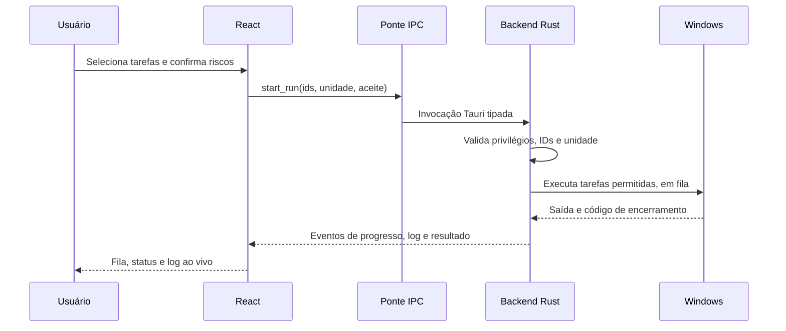

# WinCleam

> Manutenção consciente para Windows 10/11, construída com Tauri 2, Rust e React.

[](https://v2.tauri.app/)
[](https://react.dev/)
[](https://www.rust-lang.org/)
[](LICENSE)

O WinCleam é um aplicativo desktop para diagnosticar, limpar e manter o Windows. Ele reúne operações nativas conhecidas em uma experiência visual, multilíngue e orientada à segurança — sem aceitar comandos arbitrários da interface.

> [!WARNING]
> Este repositório contém o código-fonte, não um instalador pronto. As operações de manutenção exigem Windows e privilégios de administrador. Faça backup antes de executar reparos, limpezas ou ações em disco.

## Navegação

- [Começar rapidamente](#começar-rapidamente)
- [Instalar as ferramentas de build](#instalar-as-ferramentas-de-build)
- [Como o aplicativo funciona](#como-o-aplicativo-funciona)
- [Operações disponíveis](#operações-disponíveis)
- [Segurança e limites](#segurança-e-limites)
- [Desenvolvimento](#desenvolvimento)
- [Build e distribuição](#build-e-distribuição)
- [Atualizações e bandeja do sistema](#atualizações-e-bandeja-do-sistema)
- [Estrutura do projeto](#estrutura-do-projeto)

## Começar rapidamente

### Para usar o instalador

Para usar o `WinCleam_2.0.0_x64-setup.exe`, é necessário apenas Windows 10 ou 11 de 64 bits. O instalador solicita permissão de administrador e instala o WebView2 quando necessário. Não é preciso instalar Node.js, Rust ou Visual Studio para usar o aplicativo já compilado.

### Para executar pelo código-fonte ou gerar o instalador

- Windows 10 ou 11 de 64 bits;
- [Node.js LTS](https://nodejs.org/) com npm;
- [Rust](https://www.rust-lang.org/tools/install), toolchain `x86_64-pc-windows-msvc`;
- Visual Studio Build Tools com **Desenvolvimento para desktop com C++** e Windows SDK;
- WebView2 Runtime (normalmente já instalado no Windows atual).

## Instalar as ferramentas de build

Instale o Node.js LTS e o Rustup pelo PowerShell:

```powershell
winget install --id OpenJS.NodeJS.LTS -e
winget install --id Rustlang.Rustup -e
```

Depois feche todas as janelas do PowerShell, abra uma nova e instale/valide a toolchain MSVC:

```powershell
rustup default stable-x86_64-pc-windows-msvc
node --version
npm --version
rustc --version
cargo --version
```

Instale também o [Visual Studio Build Tools](https://visualstudio.microsoft.com/visual-cpp-build-tools/) e selecione a carga de trabalho **Desenvolvimento para desktop com C++**, incluindo um Windows SDK. O compilador MSVC é obrigatório para compilar o backend Rust no Windows.

<details>
<summary><code>rustup</code>, <code>cargo</code> ou <code>rustc</code> não foram encontrados após instalar o Rustup</summary>

O Rustup instala os executáveis em `C:\Users\&lt;usuário&gt;\.cargo\bin`. Para corrigir a sessão atual, execute:

```powershell
$rustBin = Join-Path $env:USERPROFILE '.cargo\bin'
if (-not (Test-Path $rustBin)) { throw "Rustup não foi encontrado em $rustBin" }
$env:Path = "$rustBin;$env:Path"
rustup default stable-x86_64-pc-windows-msvc
cargo --version
rustc --version
```

Para adicionar o caminho permanentemente ao usuário atual:

```powershell
$userPath = [Environment]::GetEnvironmentVariable('Path', 'User')
if (($userPath -split ';') -notcontains $rustBin) {
  [Environment]::SetEnvironmentVariable('Path', "$($userPath.TrimEnd(';'));$rustBin", 'User')
}
```

Feche e reabra o PowerShell depois dessa alteração.
</details>

No PowerShell, na raiz do projeto:

```powershell
npm ci
npm run dev:desktop
```

O comando abre a aplicação Tauri real. Para apenas inspecionar a interface no navegador, use `npm run dev`; nesse modo os indicadores são simulados e as operações ficam bloqueadas.

<details>
<summary>Checklist para a primeira execução</summary>

- [ ] O terminal foi aberto como administrador quando necessário.
- [ ] Há backup dos dados relevantes.
- [ ] Navegadores foram fechados antes da limpeza de cache.
- [ ] Nenhuma sessão remota/VPN crítica está em curso antes de renovar DHCP.
- [ ] RAMMap ou Process Lasso foram configurados somente se você já os instalou.
</details>

## Como o aplicativo funciona



1. A interface React permite filtrar, selecionar tarefas, escolher unidade de disco e alterar idioma/tema. Tema e idioma ficam no armazenamento local do WebView.
2. A ponte em `src/bridge.ts` só invoca comandos Tauri conhecidos. No navegador, ela fornece uma prévia segura; nenhuma manutenção é iniciada.
3. O backend Rust confirma que a aplicação está elevada, que cada ID pertence à lista permitida e que uma unidade selecionada ainda é uma unidade fixa montada.
4. Cada tarefa é executada sequencialmente, sem janela de console. O backend extrai percentuais quando o Windows os informa e transmite eventos para a UI.
5. Logs são gravados localmente e podem ser exportados. “Parar” impede o início da próxima tarefa; não interrompe uma operação já em andamento.

### Interações da interface

| Você faz | O WinCleam responde |
|---|---|
| Marca uma tarefa | Atualiza a fila e os avisos de risco. |
| Pesquisa | Filtra por nome, descrição e comando exibido no idioma atual. |
| Seleciona CHKDSK | Permite escolher uma unidade fixa ou todas; `/f` exige aceite adicional. |
| Inicia a fila | Exibe revisão, progresso determinado/indeterminado e logs em tempo real. |
| Atualiza unidades | Consulta novamente os discos fixos montados no Windows. |
| Configura RAMMap/Process Lasso | Solicita o executável original e aceita apenas nomes esperados. |

## Operações disponíveis

| Área | Ação | Comando ou comportamento |
|---|---|---|
| Sistema | Diagnosticar/reparar imagem | `DISM /CheckHealth`, `/ScanHealth`, `/RestoreHealth` |
| Sistema | Verificar arquivos protegidos | `sfc /scannow` |
| Limpeza | Limpar componentes substituídos | `DISM /StartComponentCleanup` |
| Limpeza | Configurar/executar limpeza nativa | `cleanmgr /sageset:1`, `cleanmgr /sagerun:1` |
| Limpeza | Temporários, miniaturas e caches | Lista restrita de diretórios seguros; não remove raízes ou links |
| Disco | Examinar/reparar volumes | `chkdsk X: /scan` e `chkdsk X: /f` |
| Disco | Otimizar mídias | `defrag /C /O` |
| Rede | Limpar DNS/renovar DHCP | `ipconfig /flushdns`, depois `/release` e `/renew` |
| Aplicativos | Consultar/atualizar | `winget upgrade` e `winget upgrade --all` |
| Ferramentas | Limpar standby list | RAMMap com `-Et` |

<details>
<summary>O que é preservado nas limpezas?</summary>

Os limpadores percorrem apenas caminhos previstos. Links simbólicos/junções, arquivos em uso e diretórios que não sejam regulares são ignorados. Para navegadores, o WinCleam exige que o processo esteja fechado e limpa apenas caches permitidos, preservando histórico, cookies, senhas, dados de sites, extensões e Service Workers. Não encerra programas à força.
</details>

## Segurança e limites

- IDs de tarefas, executáveis e argumentos são definidos no Rust; a busca e os campos da UI não viram comandos de shell.
- A seleção de unidade aceita somente letras de discos fixos detectados e é validada novamente antes do CHKDSK.
- `chkdsk /f` pode desmontar um volume ou ser agendado para a reinicialização. Faça backup e leia a mensagem final do Windows.
- `ipconfig /release` derruba a conexão temporariamente; evite usá-lo em acessos remotos importantes.
- RAMMap e Process Lasso não são distribuídos pelo projeto. Baixe-os das fontes oficiais e aponte seus executáveis originais na tela de ferramentas.
- WinGet atualiza aplicativos. Atualizações de driver continuam sob responsabilidade do Windows Update.
- Alguns utilitários não emitem porcentagem confiável; nesse caso o progresso é mostrado como indeterminado, sem estimativas inventadas.

## Desenvolvimento

```powershell
# Instala dependências exatamente conforme o lockfile
npm ci

# Frontend isolado (prévia segura)
npm run dev

# Desktop Tauri com hot reload
npm run dev:desktop

# Testes estáticos e validação de tipos/build web
npm test
npm run build:web
```

As traduções PT-BR, inglês britânico, ES, RU e chinês simplificado ficam em `src/i18n.ts`. A lista visual de tarefas fica em `src/model.ts`; a lista executável correspondente é mantida e validada no backend Rust. Ao criar uma tarefa, atualize ambos os lados e seus textos traduzidos.

## Build e distribuição

Para gerar o instalador NSIS de produção:

```powershell
npm ci
npm test
npm run build:win
```

O instalador será criado em `src-tauri\target\release\bundle\nsis\`. O nome inclui a versão definida em `src-tauri/tauri.conf.json` e `src-tauri/Cargo.toml`.

O instalador é por máquina, usa UAC e oferece Português (Brasil), inglês britânico, espanhol, russo e chinês simplificado. O WebView2 é baixado pelo bootstrapper do instalador quando necessário.

## Atualizações e bandeja do sistema

O WinCleam consulta a última **release estável** de [RaphaelTW/WinCleam](https://github.com/RaphaelTW/WinCleam/releases) no GitHub ao iniciar. Quando a tag publicada for maior que a versão instalada, um botão de atualização aparece na parte superior da aplicação. Ele abre a página oficial da release no navegador para que o usuário baixe e instale o pacote correspondente.

Use tags de versão semântica, por exemplo `v2.0.1`, e mantenha a mesma versão em `package.json`, `src-tauri/Cargo.toml` e `src-tauri/tauri.conf.json` antes de publicar a release. Releases de rascunho ou pré-release não são oferecidas como atualização.

Ao clicar no botão de fechar, o WinCleam permanece na bandeja do sistema. Clique com o botão direito no ícone para mostrar a janela, limpar a lista de memória em espera com RAMMap ou encerrar o aplicativo. A opção de RAM exige que o executável original do RAMMap tenha sido configurado no WinCleam e que o aplicativo esteja como administrador.

## Estrutura do projeto

```text
src/
├── App.tsx          # Interface, estado, eventos e confirmações
├── bridge.ts        # Fronteira entre React, preview e IPC Tauri
├── i18n.ts          # Textos PT/EN/ES/RU
├── model.ts         # Tipos e catálogo visual de tarefas
└── styles.css       # Temas, responsividade e acessibilidade de movimento
src-tauri/
├── src/backend.rs   # Validações, fila, processos, monitoramento e logs
├── src/cleanup.rs   # Limpeza allowlist de caches e temporários
├── capabilities/    # Permissões mínimas do WebView
├── build.rs         # Manifesto UAC do executável
└── tauri.conf.json  # Janela, CSP e bundle NSIS
tests/project.test.mjs # Verificações estáticas de integração e segurança
```

## Referências

- [Tauri 2](https://v2.tauri.app/)
- [Distribuição Tauri para Windows](https://v2.tauri.app/distribute/windows-installer/)
- [DISM e SFC — Microsoft Learn](https://learn.microsoft.com/windows-hardware/manufacture/desktop/repair-a-windows-image)
- [RAMMap — Microsoft Sysinternals](https://learn.microsoft.com/sysinternals/downloads/rammap)

## Licença

O código do WinCleam é licenciado sob [MIT](LICENSE). Dependências e ferramentas externas mantêm suas próprias licenças.
